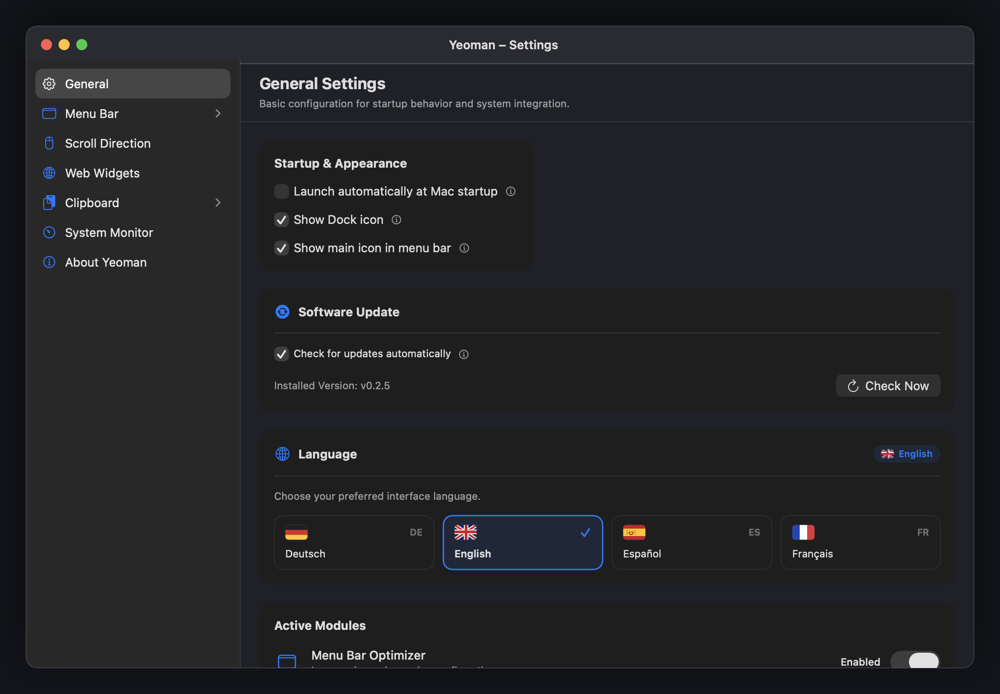
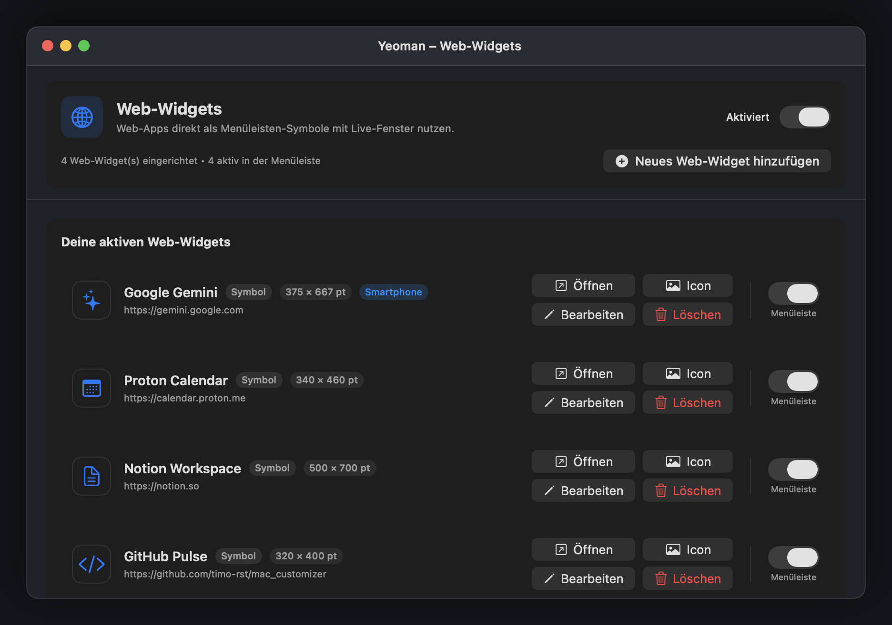
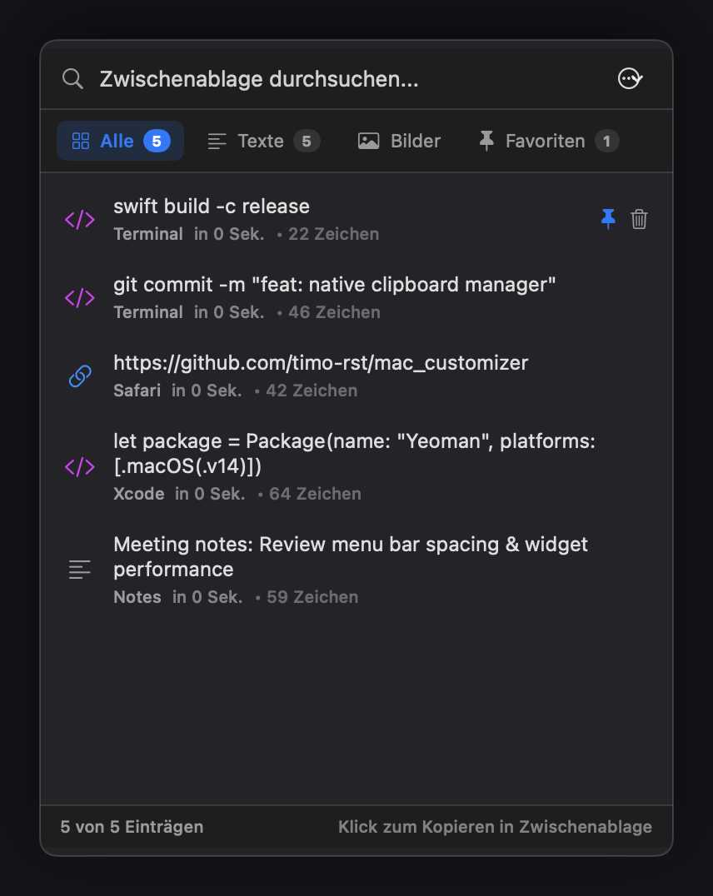
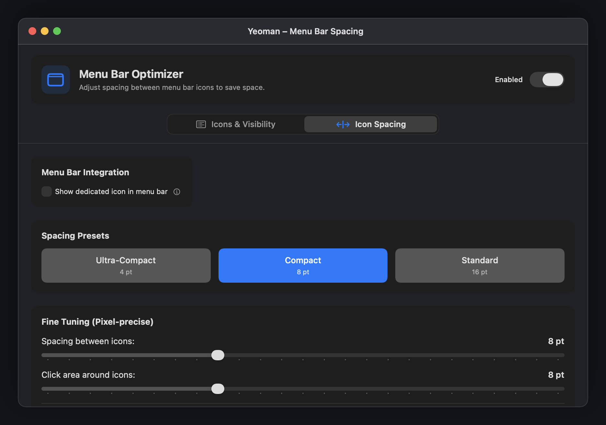

<p align="center">
  
</p>

<h1 align="center">Yeoman</h1>

<p align="center">
  Modular macOS menu bar utility built with Swift and SwiftUI.
</p>

<p align="center">
  
  
  
  
  
</p>

<p align="center">
  
</p>

---

## Overview

Yeoman is an open-source macOS menu bar tool that bundles several customization modules into a single native process. Each module can be enabled or disabled independently.

### Specifications & Resource Usage

- **Target OS:** macOS 14.0 (Sonoma) or newer. Pre-built releases currently target Apple Silicon (`arm64`); Intel source compatibility has not been release-tested.
- **Frameworks:** Apple AppKit & SwiftUI (0 external libraries or third-party dependencies)
- **Networking:** No telemetry or analytics. Web widgets access their configured sites, and the updater checks the Yeoman GitHub release endpoints when automatic checks are enabled.
- **Disk Storage:** Standard macOS Application Support directory (`~/Library/Application Support/Yeoman`) with POSIX `0700` permissions
- **Idle Memory:** ~60 MB RAM (with WebKit views unloaded)
- **Idle CPU:** < 1%

---

## Motivation & Background

This project started because several utilities I relied on broke or became incompatible across newer macOS updates. Rather than searching for separate replacements, I decided to build the specific features I personally need into a single native menu bar app.

Nothing here is reinventing the wheel—it is simply a collection of tools tailored to my personal preferences and daily workflow.

> **AI Transparency:** This project was created by prompting and guiding an AI coding assistant, which generated the implementation and automated tests. While guided in good faith with privacy and security as explicit priorities, the code was AI-generated rather than written or formally audited by hand.

---

## Modules

### 1. Web Widgets
Displays websites inside floating panels accessible directly from menu bar icons.
- **Configurable Dimensions:** Freeform width and height sliders or presets (320×400, 375×667, 500×700).
- **User Agent Modes:** Auto, forced mobile (iPhone), or forced desktop.
- **Window Pinning:** Optional pin mode to keep windows open when clicking outside.
- **Lifecycle:** Closed panels are hidden and throttled; media is suspended and caches are purged. WebKit may retain process state until the widget or app is closed.

<p align="center">
  
</p>

### 2. Clipboard History
Records copied text and images locally.
- **Privacy Filtering:** Best-effort filtering ignores standard transient/concealed markers and known password-manager patterns. Applications that omit these signals cannot be identified reliably.
- **Search & Filter:** Search by text content or filter by category (text, images, pinned favorites).
- **Storage:** Optional persistence uses AES-GCM authenticated encryption in `~/Library/Application Support/Yeoman/`. Keys are permission-restricted files under `.secrets`; this protects against other user accounts and accidental disclosure, but a malicious process running as the same macOS user can read both key and ciphertext.

<p align="center">
  
</p>

### 3. Menu Bar Spacing & Items
Adjusts layout and spacing of macOS menu bar items.
- **Item Spacing:** Adjust icon spacing from 0 to 32 pt (presets: 4 pt, 8 pt, 16 pt).
- **Item Scanner:** Lists detected system and third-party status bar items across connected displays.

<p align="center">
  
</p>

### 4. Independent Scroll Reverser
Separates scroll direction handling between mouse wheels and trackpads.
- **Event Tap:** Inverts wheel deltas using a `CGEventTap` without altering system trackpad preferences.

### 5. System Stats
Shows hardware usage in the menu bar.
- **Metrics:** CPU utilization, memory allocation, and battery status.
- **Process List:** Inspects running processes with sorting by CPU and memory usage.

---

## Installation

### Pre-built Binary
Download `Yeoman.dmg` from [GitHub Releases](https://github.com/timo-rst/yeoman/releases). Open the disk image and move `Yeoman.app` to `/Applications`.

Releases are ad-hoc signed, not notarized with an Apple Developer ID. Verify that the download came from the official GitHub release and compare its published checksum before bypassing Gatekeeper. Then open it via right-click → **Open**. If macOS still blocks the verified copy, you can clear its quarantine attribute:
> ```bash
> xattr -cr /Applications/Yeoman.app
> ```

### Building from Source
Requires Xcode 15+ or the Swift 6.0 command-line tools.

```bash
git clone https://github.com/timo-rst/yeoman.git
cd yeoman

./Scripts/build_app.sh
open dist/Yeoman.app
```

---

## Tests

The project includes unit tests covering version parsing, update host validation, clipboard privacy rules, and module lifecycles:

```bash
swift run YeomanTests
```

---

## License

MIT License. See [LICENSE](LICENSE) for details.
