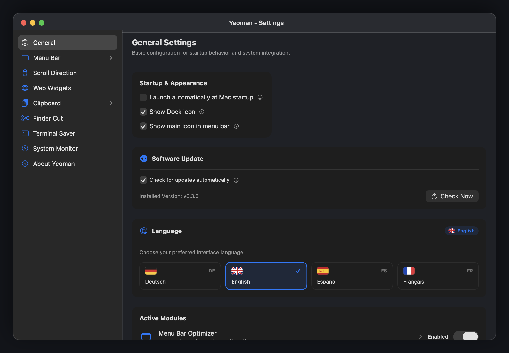
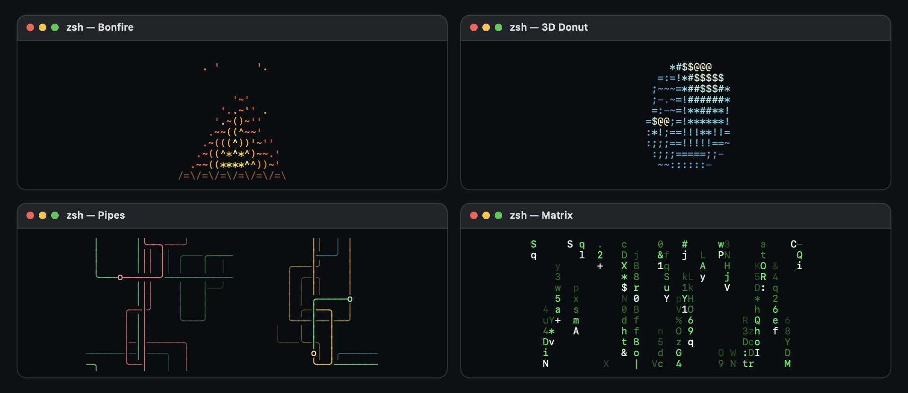
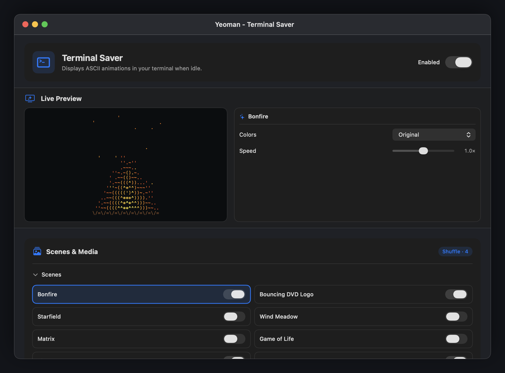
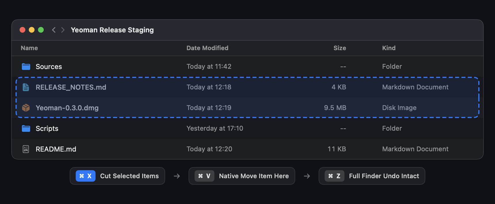
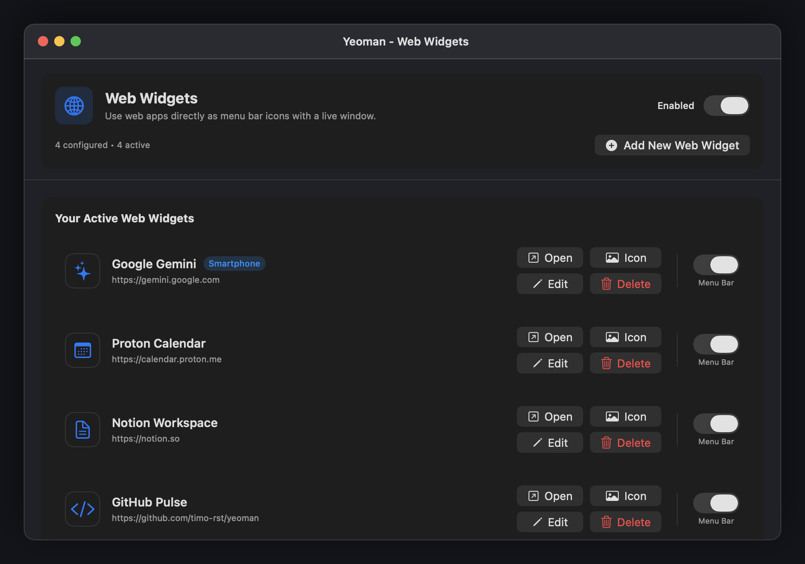
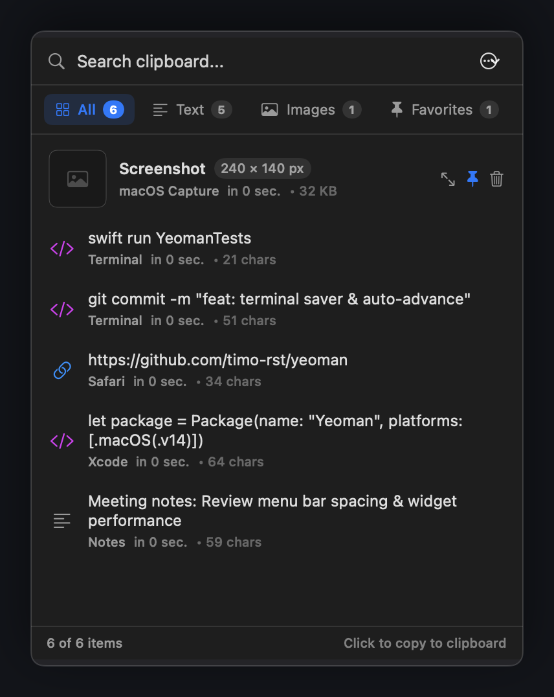
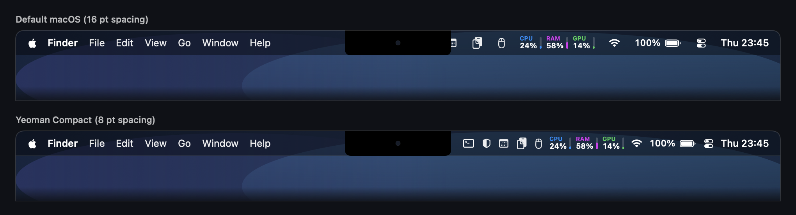
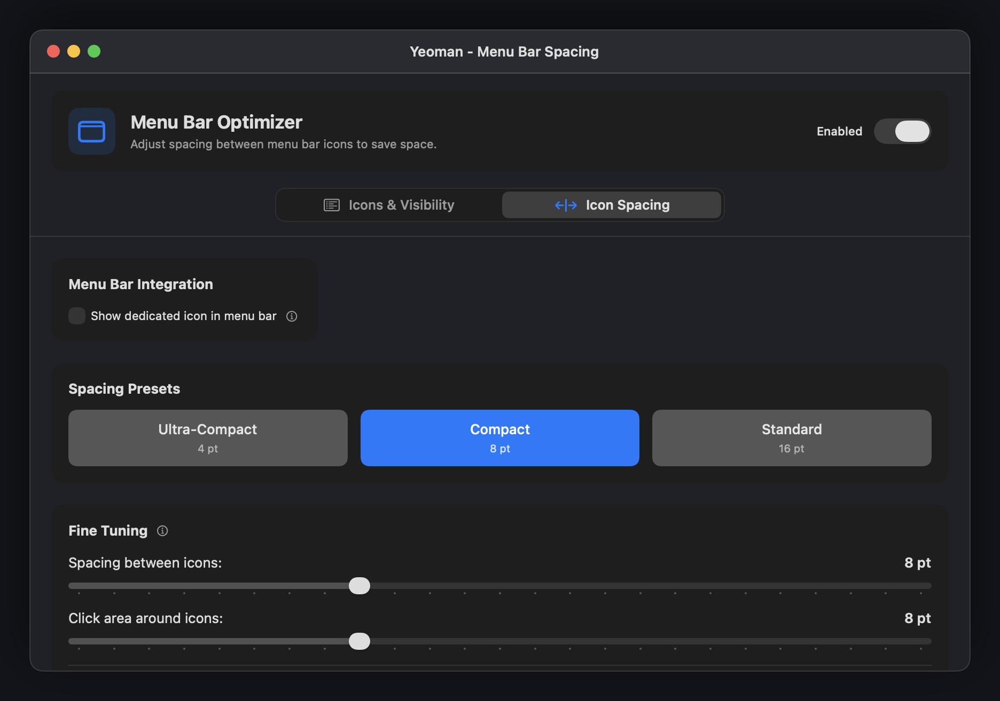
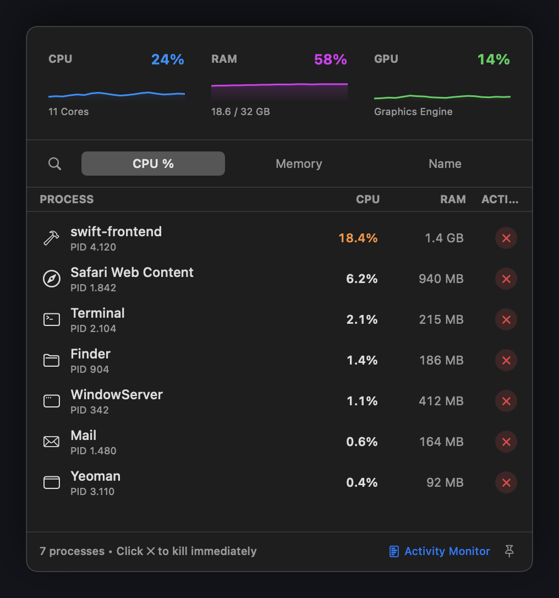
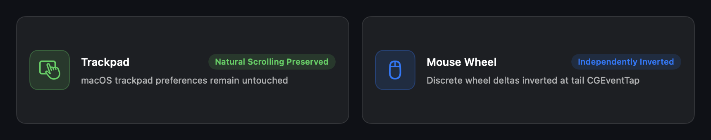

<p align="center">
  
</p>

<h1 align="center">Yeoman</h1>

<p align="center">
  Native macOS menu bar suite written in Swift and SwiftUI. Zero external dependencies, zero telemetry.
</p>

<p align="center">
  
  
  
  
  
</p>

<p align="center">
  <a href="#modules">Modules</a> &middot;
  <a href="#installation">Installation</a> &middot;
  <a href="#architecture--security">Architecture &amp; Security</a> &middot;
  <a href="#building--testing">Building &amp; Testing</a> &middot;
  <a href="#motivation--background">Personal Note</a>
</p>

<p align="center">
  
</p>

---

## Overview

Yeoman consolidates seven independent macOS productivity and system utilities into one lightweight AppKit / SwiftUI process. Every module can be toggled on or off individually, keeps zero external third-party Swift package dependencies, and runs with local-only state unless you configure Web Widgets or automatic release checks.

The settings window is configured as a normal managed macOS window: it remains accessible in Mission Control, App Expose, and standard window cycling until closed or minimized.

| Module | Purpose | Permissions |
|---|---|---|
| [1. Terminal Saver](#1-terminal-saver) | Multicolor filigree ASCII art, custom GIF/MP4 media, and interactive transitions for idle terminals | None (managed shell / tmux hooks) |
| [2. Finder Cut](#2-finder-cut-cmdx) | Windows-style file Cut & Paste (`Cmd+X` -> `Cmd+V`) with live dashed row highlights and Finder Undo | Accessibility (Finder only) |
| [3. Web Widgets](#3-web-widgets) | Persistent, isolated menu bar WebKit panels with mobile/desktop presets and sleep/network recovery | None (user-configured HTTPS sites) |
| [4. Clipboard History](#4-clipboard-history) | Local text and image history with pin-aware preview, search, filters, and optional AES-GCM encryption | None |
| [5. Menu Bar Optimizer](#5-menu-bar-spacing--items) | Adjust macOS menu bar icon spacing (0-32 pt) to reclaim notch clearance and scan status bar items | Accessibility (scanner labels only) |
| [6. System Monitor](#6-system-monitor--task-manager) | Live CPU, RAM, and GPU menu bar telemetry plus on-demand sortable Task Manager popover | None |
| [7. Scroll Reverser](#7-independent-scroll-reverser) | Separate scroll direction between mouse wheels and trackpads without touching macOS trackpad settings | Accessibility |

---

## Modules

### 1. Terminal Saver

Displays multicolor, edge-aware filigree ASCII art in any terminal emulator (`Terminal.app`, `iTerm2`, `Ghostty`, `Kitty`, `Alacritty`, `WezTerm`, `Warp`, and IDE integrated terminals) after configurable prompt or session inactivity.

<p align="center">
  
</p>

- **Filigree Edge-Aware Engine:** Combines a 3x3 Sobel directional contour pass (`/`, `\`, `|`, `-`, `~`) with block-free luminance ramps and foreground-only TrueColor or xterm-256 sequences over clean negative space.
- **8 Procedural Scenes & Custom Media:** Includes **Bonfire**, **Bouncing DVD Logo**, **Starfield**, **Wind Meadow**, **Matrix**, **Game of Life**, **Pipes**, and **3D Donut** (with independent speed, palette, and 3D Donut shading styles), alongside bounded import of animated **GIF**, **APNG**, **WebP**, **PNG**, **JPG**, **HEIC**, and **MP4/MOV** clips with optional on-device Vision foreground cutout and forward-and-reverse ping-pong loops.
- **16:9 Live Preview & Inspector:** Settings pin a 16:9 CoreText-rendered ASCII preview next to a context inspector for speed, colors, fit mode (`Contain` / `Fill`), rename, search, and immediate playback testing.
- **ASCII-Interactive Transitions & Random Mode:** Choose **Random** or pick from 7 character-level effects (**Glitch**, **Swarm**, **Decode**, **Morph**, **Shatter**, **ASCII Rain**, **Shockwave**) plus classic transitions across Start, End, and Switch events, each with an independent `0.1x-2.0x` speed control.
- **Auto-Advance & Scene Order:** Multi-source pools shuffle deterministically across sessions, preserve your position, wrap seamlessly in both directions via configurable keybindings, and support timed Auto-Advance with a choice between **Finish Loop** and **Hard Cut**.
- **Shell & tmux Integration:** Bundles a standalone `YeomanTermSaver` CLI helper managed via idempotent delimited blocks in `~/.zshrc`, `~/.bashrc`, `~/.config/fish/conf.d/`, and `~/.tmux.conf` with zero background daemon polling.

<p align="center">
  
</p>

### 2. Finder Cut (`Cmd+X`)

Brings familiar Cut & Move shortcuts (`Cmd+X` -> `Cmd+V`, `Cmd+C` / `Esc` to cancel) directly to macOS Finder without altering Finder's underlying filesystem logic.

<p align="center">
  
</p>

- **Finder-Only Scope:** Processes `.keyDown` events exclusively while `com.apple.finder` is frontmost; all other applications pass through untouched with zero keystroke logging or storage.
- **Native Accessibility Delegation:** Triggers Finder's own `Copy` and `Move Item Here` menu actions (with `.privateState` synthetic fallback), preserving native Finder Undo (`Cmd+Z`), conflict resolution dialogs, and transfer progress sheets.
- **Text-Input Safety:** Inspects the focused Accessibility role before intercepting keys so file renaming, Spotlight search fields, and text inputs retain standard text cut behavior.
- **Live Cut Highlight:** Optionally draws a click-through dashed pill outline over cut items inside Finder, merging contiguous selections into one border, clipping beneath column headers, and tracking resize drags at 120 Hz via WindowServer bounds with zero background polling when idle.

### 3. Web Widgets

Pins frequently used web applications as lightweight floating panels accessible straight from macOS menu bar icons.

<p align="center">
  
</p>

- **Presets & User Agents:** Pick from quick dimensions (`320x400`, `375x667`, `500x700`) or custom sizes and toggle between Auto, Mobile (`iPhone`), or Desktop user agents.
- **Isolated Storage & Lifecycle:** Each widget uses its own persistent `WKWebsiteDataStore(forIdentifier:)` container (with encrypted URL metadata), preloads on launch, recovers automatically from boot/login, sleep-wake, or temporary network drops via `NWPathMonitor`, and releases its SwiftUI/popover rendering surface when closed while purging volatile caches and blocking autoplay.

### 4. Clipboard History

Records copied text snippets, code, URLs, and images locally inside a fast, pin-capable menu bar popover.

<p align="center">
  
</p>

- **Pinned Popover & Image Preview:** Pin the popover open across copies, inspect images in a pin-aware floating preview panel, or open full-resolution images in a dedicated in-memory zoom viewer.
- **Best-Effort Privacy Filtering:** Ignores transient/concealed pasteboard markers (`changeCount`-verified) and common password-manager sources; applications that omit standard pasteboard markers cannot be filtered automatically.
- **Optional Encrypted Persistence:** Persisted history is encrypted with CryptoKit AES-GCM (`0700` directories, `0600` key files under `.secrets`). File permissions and AES-GCM protect against other user accounts, accidental disclosure, and ciphertext tampering, while processes running under the same macOS UID share access to local user files.

### 5. Menu Bar Spacing & Items

Tightens macOS status item padding across displays to prevent menu bar icons from disappearing behind the MacBook camera notch, and scans active system and third-party status bar items.

<p align="center">
  
</p>

- **Spacing Control (`0-32 pt`):** Switch between Ultra-Compact (`4 pt`), Compact (`8 pt`), and Standard (`16 pt`) presets or fine-tune spacing and selection padding sliders independently.

<p align="center">
  
</p>

### 6. System Monitor & Task Manager

Displays compact CPU, memory, and GPU telemetry directly in the macOS menu bar and opens an interactive Task Manager popover on demand.

<p align="center">
  
</p>

- **On-Demand Process Sampling:** Process sampling runs only while the Task Manager popover is open, sorting processes by CPU usage, memory consumption, or name.
- **Identity-Checked Termination:** Terminating a process binds PID, effective UID, and process start time, then re-validates immediately before signaling while protecting self and system PIDs.

### 7. Independent Scroll Reverser

Separates scroll direction handling for external mouse wheels and built-in trackpads without modifying macOS system trackpad settings.

<p align="center">
  
</p>

- **Dedicated Tail Event Tap:** Runs a scroll-wheel-only `CGEventTap` on an isolated user-interactive thread at the tail of macOS scroll acceleration, skipping trackpads via a zero-work pass-through path and handling TCC permission revocation gracefully.

---

## Installation

### Pre-built Binary (macOS 14.0+ Apple Silicon)

1. Download `Yeoman.dmg` from [GitHub Releases](https://github.com/timo-rst/yeoman/releases).
2. Open the disk image and drag `Yeoman.app` into `/Applications`.

> **Gatekeeper & Verification Note:** Pre-built releases target Apple Silicon (`arm64`) and are ad-hoc signed rather than notarized with an Apple Developer ID. Compare the downloaded file's SHA-256 checksum against the release notes before opening. Publisher authenticity for in-app updates is verified cryptographically via a pinned Ed25519 public key and signed release manifests (`Yeoman.update.json`). To open an ad-hoc-signed download from GitHub Releases, right-click `Yeoman.app` -> **Open**, or clear quarantine after checksum verification:
>
> ```bash
> xattr -cr /Applications/Yeoman.app
> ```

### Building from Source

Requires macOS 14.0+ and Xcode 15+ or Swift Command Line Tools:

```bash
git clone https://github.com/timo-rst/yeoman.git
cd yeoman

./Scripts/build_app.sh development
open dist/Yeoman.app
```

---

## Architecture & Security

Yeoman is engineered around fail-closed local trust boundaries and POSIX descriptor-relative filesystem isolation (`SecureDirectory`):

- **Zero External Dependencies:** Pure Swift, AppKit, SwiftUI, CoreText, WebKit, Vision, AVFoundation, Network, and CryptoKit, linking only macOS system `libarchive`.
- **No Keychain Prompt Friction:** Secrets and encrypted stores reside under `~/Library/Application Support/Yeoman/.secrets` (`0700` directories, `0600` files) using `SecureFileSecretStore` + AES-GCM instead of Login Keychain prompts for an ad-hoc-signed app. Same-UID isolation boundaries are documented explicitly.
- **Authenticated Self-Updater & Helper:** In-app updates authenticate exact archive bytes, size, SHA-256, strictly newer semantic version, and bundle identifier against a pinned Ed25519 manifest before invoking the standalone `YeomanInstaller` binary with transactional rollback.
- **Safe Archive & Media Bounds:** Untrusted archives and media enforce explicit entry, byte, pixel, dimension, frame, duration, and wall-clock limits before allocation.

For security policies, disclosure guidelines, and full implementation & audit records, read [SECURITY.md](SECURITY.md) and [docs/security/SECURITY_IMPLEMENTATION_REPORT.md](docs/security/SECURITY_IMPLEMENTATION_REPORT.md).

---

## Building & Testing

The repository uses an executable native test harness covering security invariants, archive extraction, encryption/migration, process identity, WebKit lifecycle, Finder Cut, Clipboard, and Terminal Saver:

```bash
swift build
swift run YeomanTests
swift run --sanitize thread YeomanTests
```

---

## Motivation & Background

This project started because several utilities I relied on broke or became incompatible across newer macOS updates. Rather than searching for separate replacements, I decided to build the specific features I personally need into a single native menu bar app.

Nothing here is reinventing the wheel—it is simply a collection of tools tailored to my personal preferences and daily workflow.

> **AI Transparency:** This project was created by prompting and guiding an AI coding assistant, which generated the implementation and automated tests. While guided in good faith with privacy and security as explicit priorities, the code was AI-generated rather than written or formally audited by hand.

---

## License

Released under the MIT License. See [LICENSE](LICENSE) for full terms.
