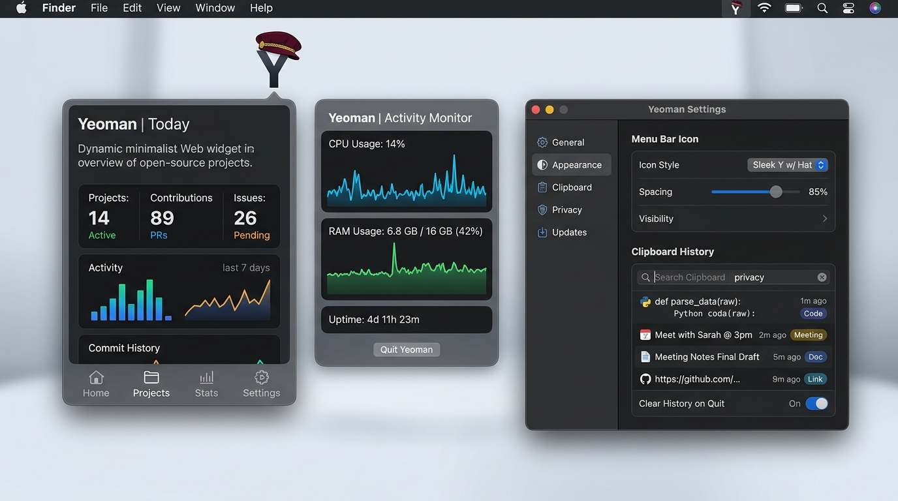

<p align="center">
  
</p>

<h1 align="center">Yeoman</h1>

<p align="center">
  <strong>Fast, modular, native macOS menu bar companion.</strong><br />
  Replaces 5 separate background utilities with a single, resource-friendly Swift app.
</p>

<p align="center">
  
  
  
  
  
</p>

<p align="center">
  
</p>

---

## The Facts

Most Mac users run 4 to 6 background apps: a clipboard history manager, a scroll reverser, a menu bar spacer, an activity monitor, and several mini-browser windows. Together, they often consume over **1 GB of RAM** and drain battery life.

**Yeoman** unifies all of them into a single, modular Swift application:
- **Idle CPU:** `< 1%`
- **Idle RAM:** `~60 MB` (vs. 800+ MB for Electron equivalents)
- **Telemetry:** `0` (no cloud sync, no tracking, completely offline)
- **External Dependencies:** `0` (built strictly on Apple AppKit & SwiftUI)

---

## Core Modules

### 🌐 1. Web Widgets (Micro-Web-Apps)
Embed any web application directly into a floating menu bar panel (Proton Calendar, Google Gemini, Notion, Todoist, ChatGPT, Jira).
- **Instant toggle** from your menu bar without cluttering your browser tabs.
- **Custom dimensions:** Sliders for any width & height (or presets: Widget, Smartphone, Large).
- **Aggressive memory throttling:** Halts timers and purges inactive WebKit caches when closed for near-zero idle RAM.
- **Pinning & navigation:** Optional pin mode to keep windows open and optional address/search bar.

### 📋 2. Privacy-First Clipboard Manager
A searchable, persistent clipboard history that respects confidentiality.
- **Strict privacy whitelist:** Unconditionally ignores passwords and secrets copied from 1Password, Bitwarden, KeePass, Proton Pass, and Apple Keychain (`org.nspasteboard.TransientType` / `.ConcealedType`).
- **Rich previews:** Syntax-tagged code snippets, images, and screenshots with dimensions.
- **Fast keyboard search:** Filter history instantly; pin frequently used snippets.
- **Local storage security:** Hardened with POSIX `0700` user-only disk permissions.

### 📏 3. Menu Bar Icon Spacing & Layout
Take back control of your menu bar, especially on MacBooks with display notches.
- **Custom padding:** Reduce or increase spacing between status icons (e.g., 4 pt, 8 pt, or custom slider values).
- **Item scanner:** Inspect running status items across multiple connected displays.

### 🖱️ 4. Independent Scroll Reverser
Fix macOS's annoying linked scroll direction without third-party bloat.
- **Natural mouse wheel + natural trackpad simultaneously.**
- Runs on a lightweight, low-level `CGEventTap` that doesn't require restarting macOS.

### 📊 5. Live Activity Monitor & Task Manager
Real-time hardware metrics without opening the bulky Activity Monitor.app.
- **Live sparklines:** Instant glance at CPU, Memory, and GPU load in the menu bar.
- **Safe task manager:** Inspect resource-heavy processes with built-in safeguards preventing accidental termination of critical system daemons (`launchd`, `WindowServer`, PID <= 1).

---

## Performance Benchmark

| Metric | Traditional Utility Stack (Separate Apps) | Yeoman |
| :--- | :--- | :--- |
| **Architecture** | 4–5 Electron / Node / Python background apps | **1 Native Swift binary** |
| **Idle Memory (RAM)** | 800 MB – 1.6 GB | **~60 MB** |
| **Idle CPU Usage** | 2% – 8% background polling | **< 1%** |
| **External Trackers** | Analytics, telemetry, auto-telemetry pings | **Zero (100% offline & local)** |
| **Launch Speed** | 3 – 8 seconds | **Instant (< 200ms)** |

---

## Installation

### Option A: Direct Download (DMG)
Download the latest **`Yeoman.dmg`** from [GitHub Releases](https://github.com/timo-rst/mac_customizer/releases), open the disk image, and drag **Yeoman.app** to your `/Applications` folder.

> **Note on Gatekeeper:** As an independent open-source release without an Apple Developer ID certificate, right-click `Yeoman.app` and choose **Open** on first launch, or run:
> ```bash
> xattr -cr /Applications/Yeoman.app
> ```

### Option B: Build from Source
```bash
git clone https://github.com/timo-rst/mac_customizer.git
cd mac_customizer

# Build and run directly
./Scripts/build_app.sh
open dist/Yeoman.app
```

---

## Development & Test Suite

Yeoman includes a zero-dependency native test harness covering semantic version comparisons, security whitelists, privacy filters, and module lifecycles:

```bash
# Run all automated tests (13/13 passing in < 1 second)
swift run YeomanTests

# Package release (.app, .dmg with /Applications link, .zip, and SHA256 checksums)
./Scripts/package_release.sh
```

---

## Project Structure

```
yeoman/
├── Package.swift                    # Swift Package Manager Manifest
├── LICENSE                          # MIT License
├── Resources/
│   ├── AppIcon.icns                 # Native macOS App Icon
│   ├── AppIcon.png                  # High-res icon preview
│   └── Mockups/                     # Interface mockups and visual documentation
├── Scripts/
│   ├── build_app.sh                 # Compiles and signs local .app bundle
│   ├── package_release.sh           # Runs tests, builds .app, and generates .dmg & .zip
│   └── ci.yml                       # GitHub Actions CI workflow template
├── Sources/
│   └── Yeoman/
│       ├── App/                     # App entry point & AppDelegate
│       ├── Core/                    # Module management, auto-updates & localization
│       ├── Modules/
│       │   ├── MenuBar/             # Spacing, item scanning & menu bar controller
│       │   ├── WebPanel/            # Web widgets, WKWebView controller & favicon manager
│       │   ├── Clipboard/           # Pasteboard monitor, image cache, history store & UI
│       │   ├── SystemStats/         # System metrics, process table & task manager
│       │   └── ScrollReverser/      # CGEventTap scroll direction controller
│       └── UI/                      # StatusItemController, settings & submenus
├── Tests/                           # Zero-dependency native unit & integration tests
│   ├── TestHarness.swift            # Lightweight assertion engine
│   ├── UpdateManagerTests.swift     # Semver & trusted host security tests
│   ├── ClipboardTests.swift         # Privacy & password manager detection tests
│   ├── WebPanelTests.swift          # Widget model serialization tests
│   ├── LocalizationTests.swift      # Multi-language coverage tests
│   ├── ModuleManagerTests.swift     # Module registry verification tests
│   └── main.swift                   # Test suite runner entry point
└── README.md
```

---

## License

Distributed under the [MIT License](LICENSE). Copyright © 2024–2026 Timo Richstein.


